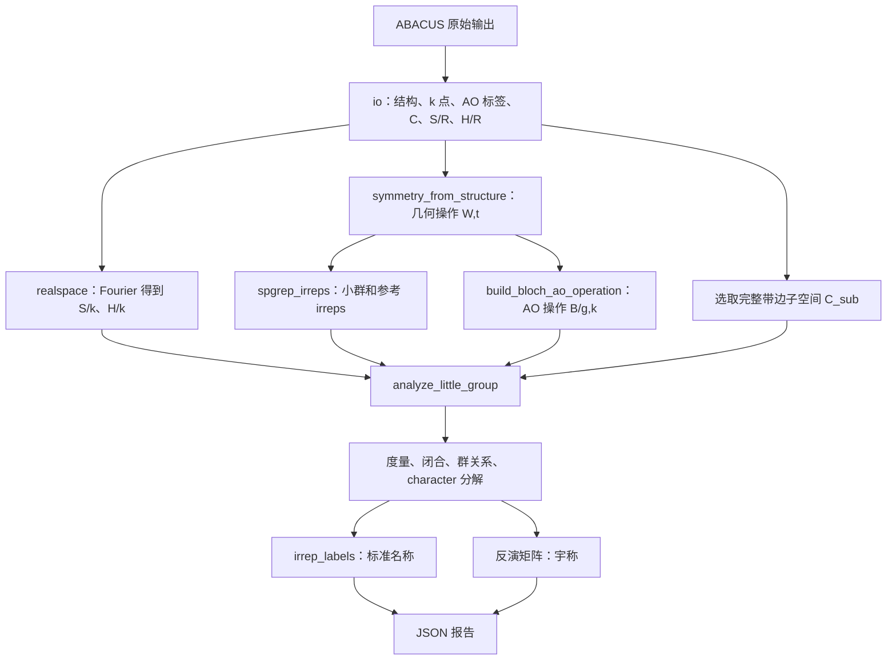

# Cs₂AgInCl₆：从 ABACUS 输出到带边 irrep 的调用链

这份说明对应 2026-10-10 的真实 PBE 快速测试，展示当前 stateid 的单电子
KS 轨道分析流程。计算使用理想 10 原子原胞、无 SOC、nspin=1，以及包含 Γ
的 2×2×2 网格；结果为 Γ 点 VBM 的 Eg（Γ₃⁺）和 CBM 的 A1g（Γ₁⁺）。

测试输入、原始输出和分析脚本保存在本地 Git 忽略目录
`.real-tests/cs2agincl6-pbe-20261010/`。本文可以随仓库分享，但该目录没有提交，
因此其他机器上不一定存在。它不是仓库自带的可运行数据集。

## 整体流程

ABACUS 由测试目录中的 `run.sh` 独立运行。stateid 不在这一流程中启动求解器，
而是通过 `analyze.py` 读取已完成计算的输出并分析。



主线是：读取同次计算的 C/S/H，从几何构造 AO 操作，将操作投影到候选带边
子空间，验证所得表示，再分解 character 并赋予标准名称。

## 1. IO：把输出变成物理数组

测试脚本首先调用以下接口。文件布局停留在 IO 层，不进入后面的表示理论计算。

| 函数 | 本次读取文件 | 返回的主要信息 |
|---|---|---|
| `read_structure` | `STRU`、`STRU_FINAL` | 晶胞、分数坐标、原子顺序 |
| `read_scf_log` | `running_scf.log` | 收敛状态、ABACUS 版本、能量 |
| `read_kpoints_info` | `KPT.info` | 实际 k 点、编号和原始权重 |
| `read_multik_wavefunctions` | `WFC/*.txt` | 每个 k 的轨道系数 C、能量、原始占据 |
| `read_ao_labels` | `Orbital` | 每行 AO 的 atom/ell/zeta/m |
| `read_csr` | `srg1_nao.csr`、`hrs1g1_nao.csr` | 稀疏 S(R)、H(R) 容器 |

实现位置：

- [metadata.py](../src/stateid/io/metadata.py)：结构、k 点、INPUT 与 SCF 日志。
- [abacus.py](../src/stateid/io/abacus.py)：波函数与多 k 集合读取。
- [ao_labels.py](../src/stateid/io/ao_labels.py)：AO 行标签。
- [csr.py](../src/stateid/io/csr.py)：新旧文本 CSR。

C 按列存轨道、按行存 AO。本次每个 k 的 C 为 `127×65`，S/H 为 `127×127`。
AO 标签连接系数行与具体原子、角动量、径向壳层、球谐分量。`Orbital` 首列是
重复的原子编号，不能把它当作全局 AO 编号；数据行顺序才对应 C 的行顺序。

集合 reader 显式接收 `nspin=1`，读取 `wfk{k}g1_nao.txt`，不添加 `s1` 后缀。
它会调用单文件 `read_wavefunctions`，并核对头部 k 编号与坐标。
ABACUS 原始 occupation 可包含 k 权重和自旋简并因子，不能直接当作每条轨道
的真实分数占据。本次 Γ 点占据带的原始值为 0.25。

脚本先确认 SCF 收敛，并比较输入/最终物理晶胞、周期等价原子位置，防止错配几何。

## 2. RealSpaceMatrix：得到同一 k 点的 S 和 H

`read_csr` 返回与软件后端无关的 `RealSpaceMatrix`，然后调用：

```python
sks = sr.to_k(points.fractional)
hks = hr.to_k(points.fractional)
```

[realspace.py](../src/stateid/realspace.py) 使用 cell gauge：

$$X(k)=\sum_R e^{+2\pi i k\cdot R}X(R).$$

k 使用倒格分数坐标，不额外乘 k 权重，不除以 R 数。波函数头部的 Cartesian k
需要用原始 STRU 的无量纲晶格矩阵转换，不能用低精度 CSR 晶胞头替代。

本次在全部 8 个 k 点检查：

$$C_k^\dagger S(k)C_k\approx I,\qquad
H(k)C_k\approx S(k)C_k\varepsilon_k.$$

这些是 C/S/H 联合一致性检查；后续子空间正交化不能代替对原始数据的这一检查。

## 3. 几何操作分成两条路线

```python
rotations, translations = symmetry_from_structure(
    cell.lattice_angstrom, cell.fractional_positions, cell.species_ids)
```

[groups.py](../src/stateid/symmetry/groups.py) 中的 `symmetry_from_structure`
调用 spglib，返回分数坐标 Seitz 操作 `(W,t)`。本次原胞得到48个操作。
这只证明几何具有相应对称性，电子解是否保持这些操作须独立验证。

### 路线 A：准备参考不可约表示

```text
spgrep_irreps(W, t, k)
├─ find_little_group(...)
│  ├─ 筛选 W⁻ᵀk = k + G
│  └─ 建立乘法表、晶格余项和 factor system
└─ spgrep：生成不可约表示，并校验顺序、群关系和完备性
```

入口在 [irreps.py](../src/stateid/symmetry/irreps.py)。本次 k=Γ，所以全部48个
操作属于小群。`IrrepSet` 保存小群、参考矩阵及 character，使用 `irrep_0` 等
本次结果内部 ID；这些 ID 不能直接解释为 Γ₁、Γ₃ 等标准名称。

有限 k 的群乘法可能包含平移相位，`find_little_group` 会保留相应 factor system。

### 路线 B：构造作用于真实 AO 系数的操作

```text
build_bloch_ao_operation(...)
├─ 将 W/t 转成笛卡尔旋转和平移
├─ build_gamma_ao_operation(...)
│  ├─ 找周期原子映射与返回晶格矢量
│  ├─ 检查 species、完整 m 壳层及径向 zeta 对应
│  └─ real_harmonic_operation(...)：s/p/d 主动旋转或镜面
└─ bloch_from_ao_operation(...)：加入逐源 AO 列的 Bloch 相位
```

实现分布在 [bloch.py](../src/stateid/symmetry/bloch.py) 和
[ao.py](../src/stateid/symmetry/ao.py)。晶胞矩阵 A 的晶格矢量按行存储：

$$R_{\rm cart}=A^TWA^{-T},\qquad t_{\rm cart}=tA.$$

原子映射和 Bloch 操作满足：

$$W\tau_a+t=\tau_b+L_{g,a},\qquad
B_{b\mu,a\nu}(g,k)=T_{b\mu,a\nu}(g)e^{-2\pi i k'\cdot L_{g,a}},
\qquad k'=W^{-T}k.$$

本次 Γ 点所有 Bloch 相位为1，因此 B=T。有限 k 时该相位不可省略。
返回的 `BlochAOOperation` 保存 B、源/目标 k 及原子映射信息。
当前 builder 支持标量 s/p/d；不支持更高 ell、SOC 或 spinor。

## 4. 选候选带边空间，然后验证实际表示

脚本调用 [select_band_edges](../src/stateid/bands.py)，从指定 k 的能量和占据数
选择局部带边及完整的近简并候选空间，不硬编码带号：

```python
from stateid.bands import select_band_edges

edges = select_band_edges(
    data.energies_ry, data.occupations,
    full_occupation=2 * points.weights[ik],  # 本次显式 nspin=1
    energy_tol=1e-6,                         # 与输入能量同单位：Ry
)
chosen = {"VBM": edges.valence_indices, "CBM": edges.conduction_indices}
```

函数按最大占据能量、最小未占据能量定位带边，再纳入距相应边缘不超过
`energy_tol` 的全部轨道；不要求输入按能量排序。返回的 indices 是零基 C 列索引，
输出带号通过 `data.band_numbers[indices]` 取得。

原始满占值必须显式提供：ABACUS 的 wg 在 nspin=1 时是 `2*w_k`，在 nspin=2
时每个自旋通道是 `w_k`。函数不根据观测到的最大占据猜满占尺度。
部分占据、缺少空带/占据带、非正或未分辨带隙都会明确拒绝；金属/展宽的
费米面选择需另设规则。零权重 k 的 wg 本身无法用于占据判断。

本次自动得到 VBM 第45/46带和 CBM 第47带。能量接近仅用于选择候选空间，
不是 irrep 结论；之后仍须独立验证闭合。

分析指定 k 的小群表示只需要该采样点的数据，不必先找到全布里渊区极值。
Γ 点的“局部最高占据/最低空态”与全局 VBM/CBM 在一般体系中可能不同。
脚本额外对各采样 k 自动取局部边缘并比较，记录网格带边；这一步不是 Γ irrep
分析的前提，也不保证未采样位置不存在更高/更低能量。

核心入口为：

```python
result = analyze_little_group(C_sub, operations, reference, S_gamma, atol=1e-5)
```

实际内部调用链：

```text
analyze_little_group(...)
├─ 每个操作调用 project_representation(...)
│  └─ project_sewing_matrix(...)：源与目标取同一空间
│     ├─ orthonormalize(...)：得到 Q
│     ├─ 投影 D(g) = Q† S B(g) Q
│     ├─ 检查 B†SB ≈ S
│     └─ 检查 BQ ≈ QD
├─ representation_errors(...)：酉性、群乘法
└─ decompose_characters(...)：χ(g)=Tr D(g) 的不可约分解
```

投影核心在 [representation.py](../src/stateid/symmetry/representation.py)：

$$G=C_{\rm sub}^\dagger SC_{\rm sub},\qquad
Q=C_{\rm sub}G^{-1/2},\qquad D(g)=Q^\dagger SB(g)Q.$$

如果 G 奇异，函数拒绝输入，不静默删除轨道。闭合误差为：

$$\epsilon_g=\frac{\|B(g)Q-QD(g)\|_S}{\sqrt d}.$$

`project_representation` 是同一空间内的表示接口；它复用较一般的
`project_sewing_matrix`。后者也可连接不同 k 的源/目标空间，但跨 k sewing matrix
的 trace 不作为 character 使用。

本次127维 AO 操作投影到 VBM 后得到2×2的 D，投影到 CBM 后得到1×1的 D。
度量或闭合失败时 `analyze_little_group` 会抛错。全部操作通过后，它检查
酉性和群乘法，再由 [tables.py](../src/stateid/symmetry/tables.py) 的
`decompose_characters` 计算：

$$n_\alpha=\frac{1}{|G_k|}\sum_{g\in G_k}
\chi_\alpha(g)^*\chi_{\rm sub}(g).$$

本次使用每操作一个 character，不是类内求和。分解检查非负整数重数和重构误差，
结果可为单个 irrep 或可约表示；调用者仍须检查 `result.match.valid`。

## 5. 标准命名与实际宇称

[labels.py](../src/stateid/symmetry/labels.py) 的命名调用链是：

```text
irrep_labels(reference, cell, ..., "GM")
├─ IrRep / irreptables：读取该空间群 Γ 点的标准 character 表
├─ labels_from_character_table(...)：对齐操作和代表元相位
└─ match_irrep_labels(...)：匹配参考 character，建立 ID → 标准名映射
```

本次标签来源是 IrRep 3.3.0 / irreptables 3.1.0、BCS SG225、k=GM。
命名层独立于实际轨道投影：它可以先为参考 irreps 建好名称映射，待真实子空间
分解得到局部 ID 后，再映射成 `GM3+` 或 `GM1+`。名称不按枚举序号猜测。
宇称其实就是反演操作I在带边子空间的表示矩阵的本征值。找到 `W=-I` 的反演操作，取：

```python
parity = result.representations[inversion_index].matrix
```

其本征值给出 VBM 的 `[+1,+1]` 和 CBM 的 `[+1]`，与标准标签中的 `+` 一致。

## 6. 本次独立验证与报告

在主流程之外，测试脚本还检查：

- Cartesian d(z²,x²−y²) 的 Eg 模型和常数 A1g 模型，与真实 character 独立对照。

  - 这是用**已知的简单函数构造参考表示**，独立核对真实波函数的 character。
    对于 E\_{g}，采用两个函数作为基底：f₁=2z²-x²-y²,  f₂=x²-y². 它们分别对应常说的 d\_{z²} 和 d\_{x²-y²} 角向形状。在立方群操作下，这两个函数彼此混合，并始终留在这个二维空间中，所以构成 E\_{g} 表示。对每个操作计算其 **2×2 变换矩阵的 trace**，便得到参考 character。

    对于 A\_{1g}，采用常数函数：f(r)=1. 任何旋转、镜面或反演都不改变它，因此表示矩阵始终为 `[[1]]`，每个操作的 character 都为 1。

    测试代码将这两套参考 character，与从真实带边波函数投影得到的 character 比较。**这里没有假设 VBM 就是两个纯 Ag d 轨道，或 CBM 就是常数函数**：真实态可以含多个原子和轨道成分，只要它们整体按相同方式变换，就属于相同 irrep。
- VBM 经随机复 U(2) 混合后 character 不变。
- 单取一个 VBM 分量会因子空间不闭合被拒绝。
- Γ 点全部48个操作满足 B†HB≈H，确认电子哈密顿量保留几何群。
- 全8 k的数据一致性、网格带边、Mulliken 分组权重及输入输出 SHA256。

| 本次 Γ 带边 | 标准名 | Mulliken 名 | 反演宇称 | 闭合误差 |
|---|---|---|---|---|
| 第45/46带完整 VBM | GM3+ / Γ₃⁺ | Eg | +1,+1 | 7.07×10⁻¹⁰ |
| 第47带 CBM | GM1+ / Γ₁⁺ | A1g | +1 | 1.52×10⁻¹⁰ |

全8 k的 max|C†SC−I| 为5.41×10⁻⁹，max|HC−SCε| 为4.85×10⁻⁹ Ry。
随机混合后的 character 变化约1.33×10⁻¹⁵。
结果写入本地 `stateid-report.json`，附原始数据校验和。

Ag/In 使用原生 SZ s/p/d 基组，Cs/Cl 使用较大基组。这是快速对称性验证，尚未做
基组、k 网格或结构收敛；1.122 eV 的 KS gap 不是精度基准。
VBM 的分组 Mulliken 权重主要为 Ag d 与 Cl p；CBM 在该基组下为混合 s 态。
Mulliken 权重可为负，不能当作严格概率，也不能由径向 zeta 直接判定主量子数。

在拥有本地数据的机器上，从仓库根目录复现后处理：

```bash
OPENBLAS_NUM_THREADS=1 OMP_NUM_THREADS=1 PYTHONPATH=src .venv/bin/python \
  .real-tests/cs2agincl6-pbe-20261010/analyze.py
```

## 代码结构与阅读顺序

| 层 | 主要文件 | 责任 |
|---|---|---|
| 带边候选 | `bands.py` | 从一个 k/spin 块的能量和占据选择子空间 |
| 算例编排 | 本地 `analyze.py` | 选择空间、组合接口、独立验证、写报告 |
| 软件 IO | `io/metadata.py`、`abacus.py`、`ao_labels.py`、`csr.py` | 原始输出与索引/坐标契约 |
| 实空间容器 | `realspace.py` | X(R) 与 X(k) |
| 几何群 | `symmetry/groups.py` | 找群、小群、乘法及相位 |
| AO 操作 | `symmetry/ao.py`、`bloch.py` | 几何操作 → AO 系数操作 |
| 子空间投影 | `symmetry/representation.py` | Q、D、度量与闭合诊断 |
| irrep 分析 | `symmetry/irreps.py`、`tables.py` | 参考 irreps、群关系与 character 分解 |
| 标准标签 | `symmetry/labels.py` | character → 标准名称 |

建议沿 **IO → realspace → ao/bloch → representation → irreps → labels** 阅读。
其中 `representation.py` 是轨道分析与跨 k 映射共享的数学核心。

本次走的是 KS 单电子空间标签流程，没有进入 `symmetry/lr.py` 的 TDA 根分析，
也没有使用 `spin/` 计算自旋。总激发态空间标签还需要 ph 操作、完整根子空间和
参考态相位；自旋多重度则需要独立证据。

相关说明：[Bloch/小群教程](../docs/tutorials/07-bloch-little-group.md)、
[真实非 Γ NV 验证](../docs/tutorials/08-real-abacus-nv.md)、
[AO/TDA 教程](../docs/tutorials/06-ao-tda-symmetry.md)。

## 操作本征值与混合宇称

每个 `Representation` 现在提供 `eigenvalues` 属性，与 `character` 一起可读取：

```python
rep = result.representations[inversion_index]
print(rep.character, rep.eigenvalues)
```

`eigenvalues` 是表示矩阵的一般复本征值，不排序、不取实部、不强制舍入为±1。
旋转的本征值通常为复相位；经过闭合、酉性和群关系验证后，才解释这些数值。
其和应等于 character。谱作为集合在酉换基下不变，但数组位置不对应原始 band；
不同操作通常不能同时对角化，不能将各操作的第一个本征值串成“第一条轨道标签”。

Cs₂AgInCl₆ 本地报告在每个 band edge 的 `operations` 列表中同时记录操作 index、
分数坐标 W/t、character 的实/虚部、本征值的实/虚部及闭合误差。
`inversion_operation_index` 标明反演对应的记录。真实 NV 示例的每个 band record
同样输出 `eigenvalues_real/imag`，并保存与 character 一致顺序的操作 W/t。

反演满足 I²=1，若所选空间确实闭合，其本征值为±1。二维空间可以有
`[+1,-1]`：它包含一个偶宇称方向和一个奇宇称方向，反演 character 为0。
即使原始基是二者的混合，仍可对角化反演矩阵得到这两个方向。

在本次 Γ 点的中心对称普通点群中，反演与全部群操作对易。因此单个不可约表示
内反演必须为+I或−I。混合宇称的二维空间是可约的，至少分为一个 g 和一个 u
部分，不是单个 Eg/Eu。能量上两者可以偶然简并；简并不意味着它们属于同一 irrep。
仅由反演谱不能确定完整的点群标签，仍需全部操作的 character 分解。
本次 VBM 为 `[+1,+1]`、χ(I)=2，CBM 为 `[+1]`、χ(I)=1。

在一般有限 k，反演将 k 映射到−k。只有−k与k相差倒格矢时，才可以在同 k 小群
中讨论这样的宇称；否则需用跨 k sewing matrix，不能把其谱直接解释成宇称。
